# Painted buildings

All four buildings have painted artwork for rotation **r0**. Sources and the exact import commands
are in [`art-source/README.md`](../art-source/README.md).

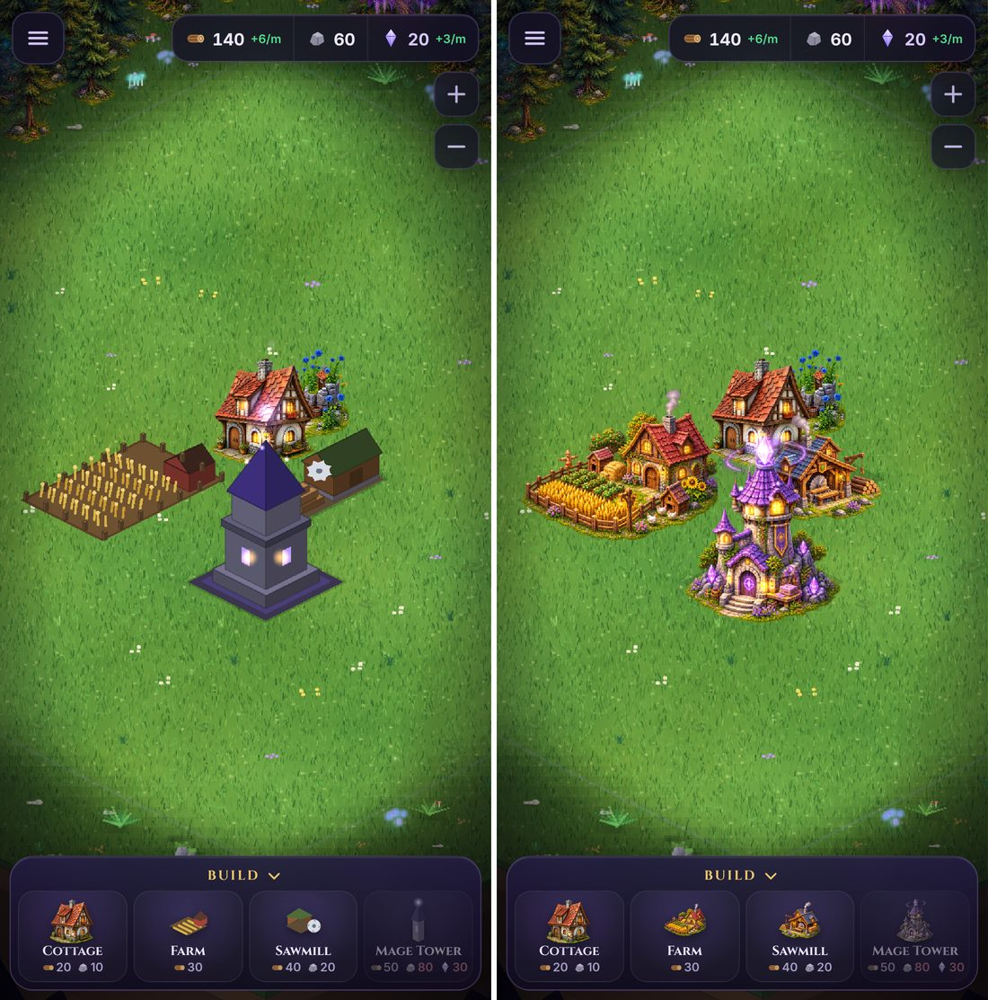
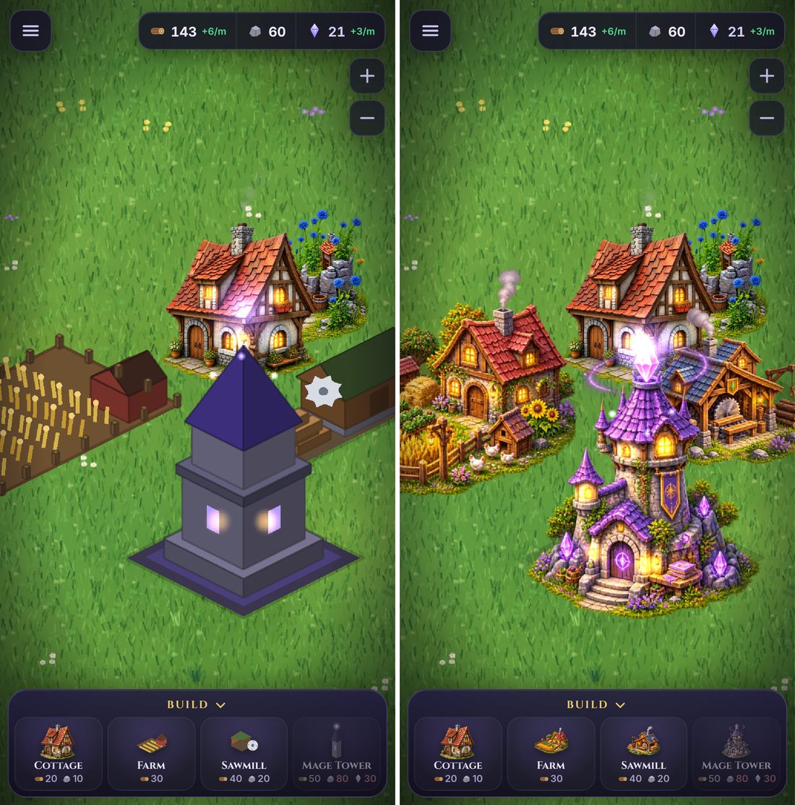
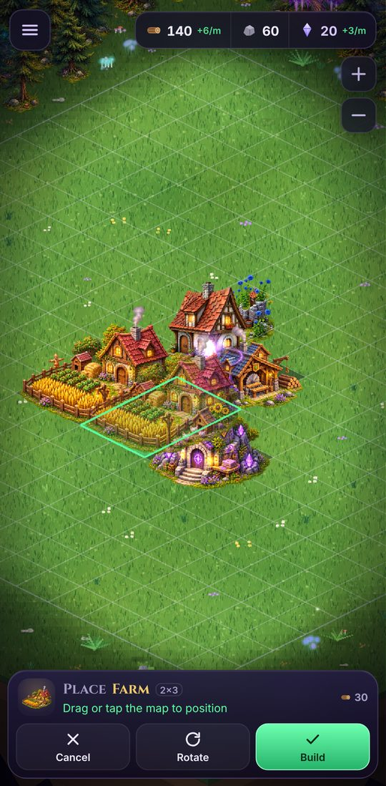

| Building | Logical footprint (unchanged) | Canvas | Effects |
| --- | --- | --- | --- |
| Cottage | 1×1 (+ garden ground layer) | 544 × 416 | chimney smoke, 5 window glows |
| Farm | **2×3** | 704 × 544 | subtle animated chimney smoke (the static painted plume was removed), 6 window/lantern glows, butterflies |
| Sawmill | **2×1** | 448 × 448 | chimney smoke, 4 window/lantern glows, sawdust at the blade |
| Mage tower | **2×2** | 576 × 1024 | soft halo and runes on the crystal, 5 window/lantern glows, sparkles on the ground crystals, door rune and spell book |
| Blacksmith | **2×1** | 448 × 448 | chimney smoke; forge fire, coal bed, two lanterns and the gable window glow |
| Castle Keep | **4×4** | 1088 × 1280 | warm flicker on eleven lit windows, both gate lanterns and both braziers; warm embers rise from the braziers; no smoke; banners painted (static) |
| Ancient Temple | **3×3** | 832 × 768 | ice-blue breathing halo on the floating crystal, cyan glints and rising motes on the runes, statue orbs and altar, warm flicker on the braziers; no smoke |
| Marketplace | **3×2** | 704 × 512 | ten warm lantern and window glows (eight lanterns, two hall windows); the hall's chimney is capped, so no smoke |
| Tavern | **2×2** | 576 × 640 | both dormers, the big latticed window, the hanging lantern and two table lanterns glow; **animated chimney smoke** from the chimney mouth (the static painted plume was removed) |
| Alchemist's Workshop | **2×2** | 576 × 640 | **emerald sparkles** on the copper still and three potion flasks; the dormer, arched window, kiln mouth and porch lantern glow; delicate, softly glowing **mint chimney smoke** (the static painted plume was removed) |

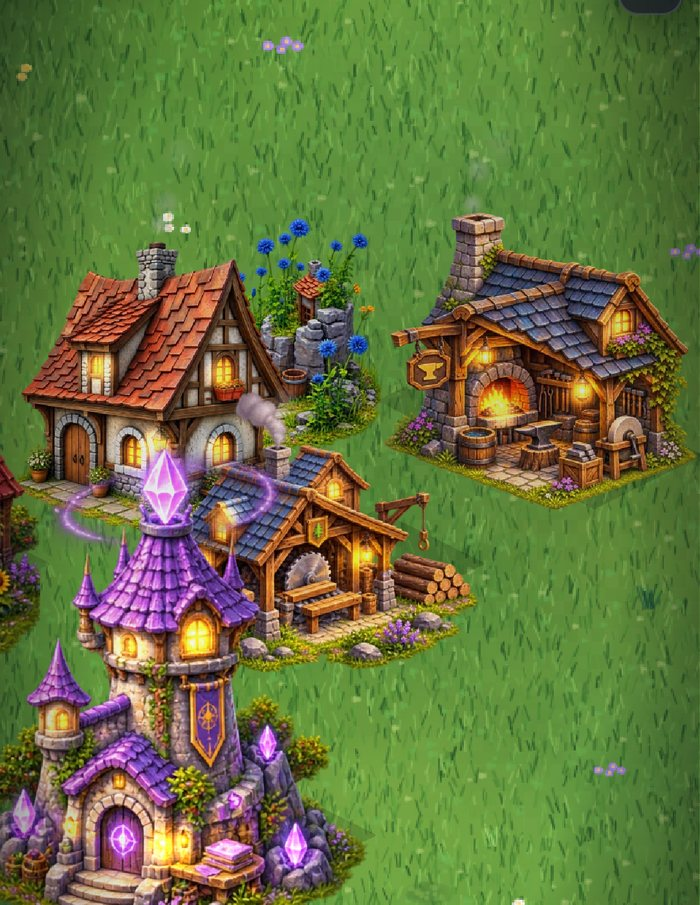

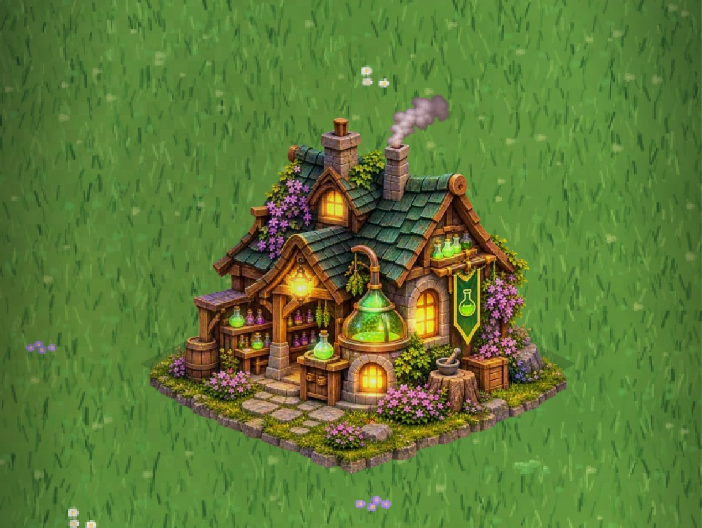

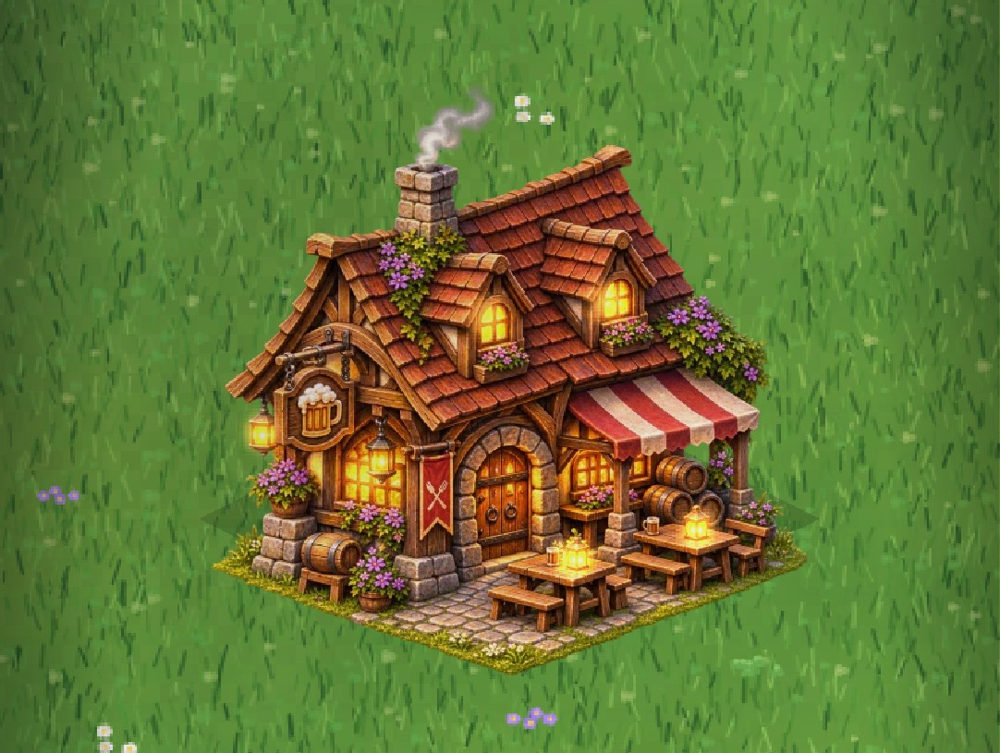

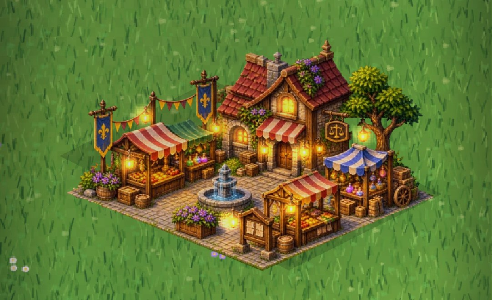

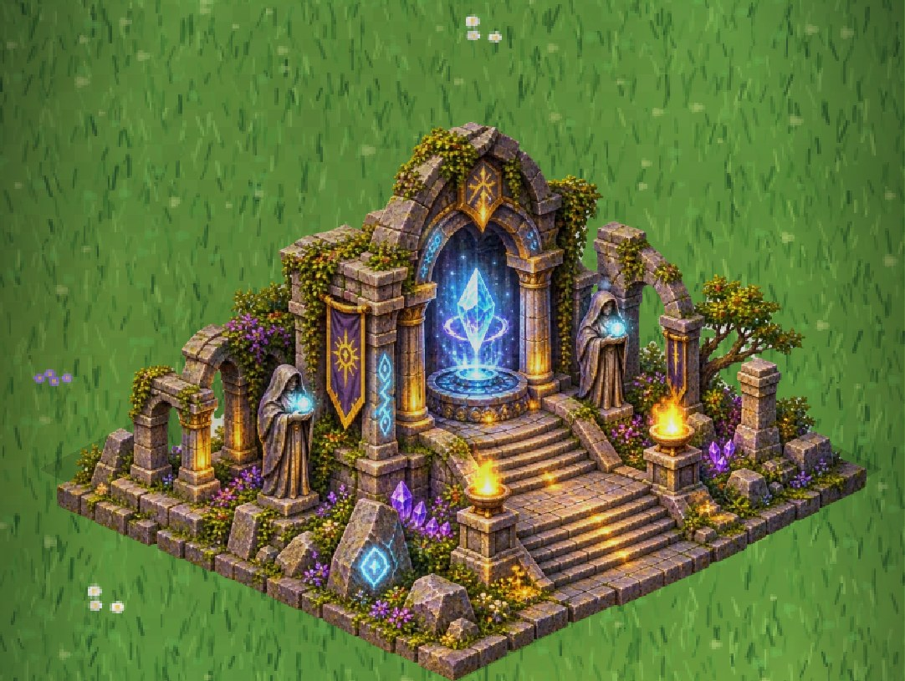

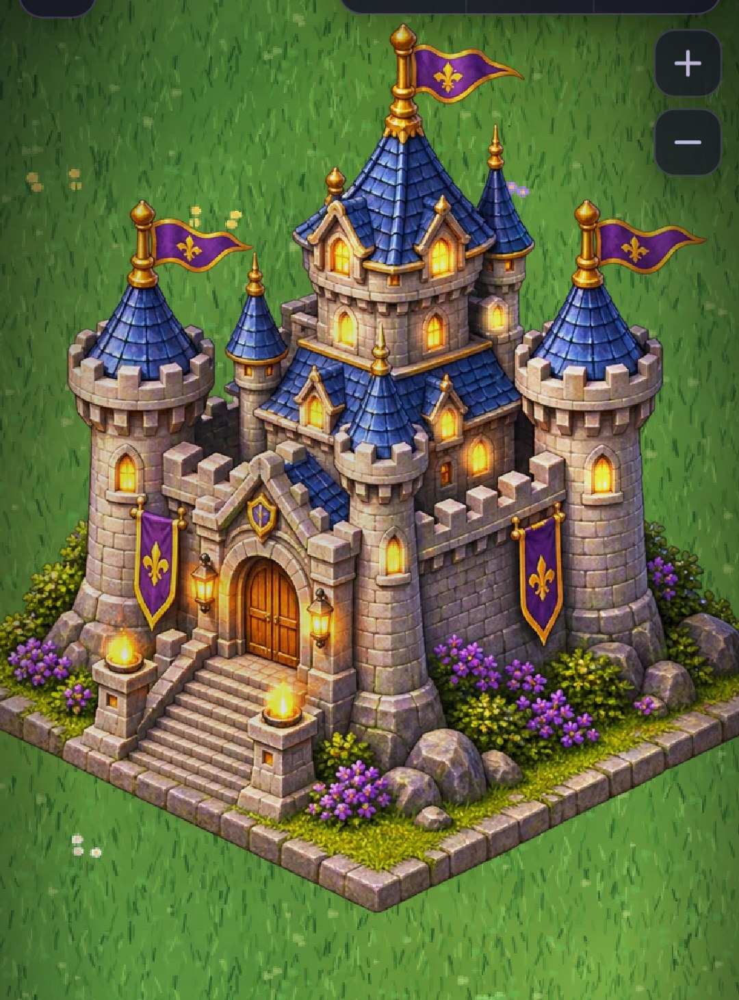

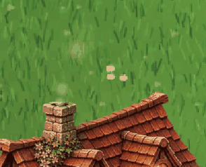

Gameplay is untouched: footprints, costs, production, collision, placement rules and saves
(format v1) are all as before. `tests/buildingArt.test.ts` pins the footprints and costs.

**How the art was fitted.** Each image is a small diorama: the building on its own grass base.
The importer scales each one so its base spans the logical footprint's width (96%), puts the
lowest point on the footprint's front corner, and leaves the rest of the canvas transparent. The
art never extends past the footprint to the left or right, so side neighbours are never covered.

**Build menu and action bar.** The icons use the same painted sprites, cropped to each
building. This happens automatically whenever a painted r0 exists.

**Performance** (Pixel 7 profile): 20–21 WebGL draw calls per frame (15–16 before; each building
is its own texture), and about 4,400 vertices per frame instead of about 17,300, because the
procedural building geometry is gone.

## Visual limitations

- **Grass bases overhang the front edges.** The painted grass rim reaches 11–20 world px
  (up to about 0.6 of a tile's depth) past the footprint's two front edges: farm up to 20 px,
  sawmill 17, mage tower 11. It's decoration only and never blocks a tile, and a building
  placed in front draws over it.
- **Sawmill shape.** The sawmill was painted on a roughly square base, but its footprint is a
  long 2×1. Fitted to the footprint width, the building is a little small and the grass bulges
  in front of the short edge.
- **Clipped edges in the source crop.** The farm's right-hand bush and the bush beside the
  sawmill's timber pile end in a straight vertical cut (37 and 29 source px, about 9 and 7 world
  px). It's small, but visible up close.
- **Blacksmith orientation.** It was painted with its long forge front facing front-right (the
  1×2 view), so it is mirrored to fit the 2×1 footprint. The light then comes slightly from the
  right instead of the left. Its plot is nearly square (1 : 1.2), so like the sawmill the grass
  reaches up to 12 world px past the short front edge. Turning it (r1/r3) shows the painting
  exactly as delivered.
- **Alchemist colour.** Its sparkles use the building's own **emerald** palette
  (`src/game/effectPalette.ts`) instead of the mage tower's violet.
- **Tavern orientation and base.** Its door and patio face front-right instead of the r0
  front-left, but it is kept as painted: the light comes from the top-left like every other
  building, and mirroring would flip it. Gameplay doesn't depend on which face the door is on;
  turning the Tavern (r1/r3) shows the door front-left. Its base is painted slightly flatter than
  2:1, so the grass at the side corners sits about 9 world px below the footprint's side corners.
- **Painted smoke removed (Tavern, Farm, Alchemist, Sawmill).** These paintings came with a smoke plume
  baked in. A painted plume can't move, so in game it read as frozen smoke (or, on the farm, as
  a second plume under the animated one, on the farm and sawmill). The importer erases the plume after alignment
  (`--erase`, output px) and retouches the pale smoke stub left inside the chimney mouth from
  the dark mouth beside it (`--inpaint`, 18–40 px). On the alchemist, the smoke that hid the
  cap's back rim is trimmed to the rim's peaked outline. Every other pixel is exactly as before
  (tested). Each building then emits its own smoke style from the chimney mouth
  (`SMOKE_STYLES` in `src/game/effectPalette.ts`): a slightly denser column for the Tavern,
  subtle puffs for the Farm, and delicate, softly glowing mint wisps for the Alchemist. The
  cottage, sawmill and blacksmith keep the original smoke. The selection markers sit on the
  roofs.

  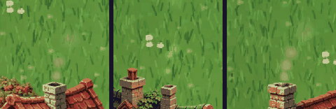
- **Smoke audit.** Every chimney (cottage, farm, sawmill, blacksmith, tavern, alchemist) emits
  animated smoke from the middle of its dark opening with open sky above, and none has a
  painted plume left (`tests/buildingArt.test.ts`, "smoke audit"). The mage tower has no
  chimney. The sawmill's emitter moved 4 px up into the opening and the blacksmith's 7 px right
  and 4 px up (it was on the cap's front stones).

  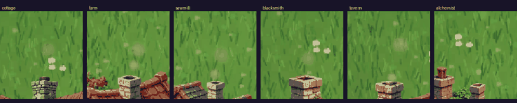
- **Marketplace cut-out, fit and scale.** It was delivered opaque on a grass field and cut out by
  `scripts/cutout-marketplace.py` (see `art-source/README.md`). Its plaza is painted squarer
  and flatter than a true 3×2, so fitted by width the front and right corners land on the
  footprint and the left corner sits about 15 world px low. It paints a whole market square
  (hall, five stalls, fountain, tree) on 3×2 tiles, so everything is at about **half the
  village scale**: the hall's door and windows are roughly half the Tavern's.

  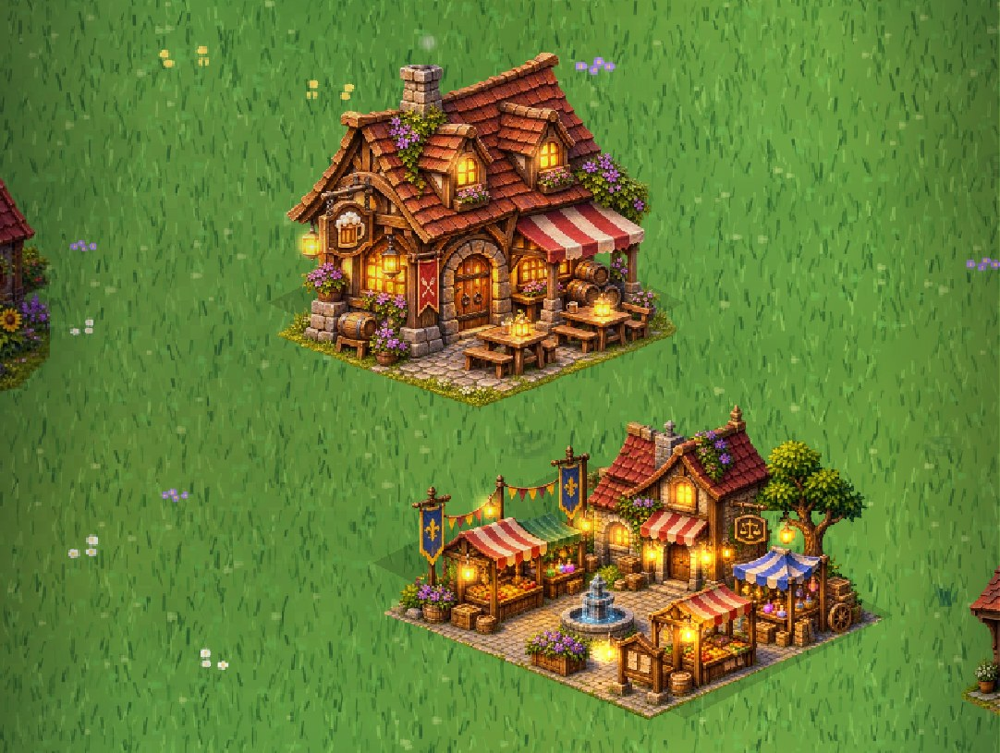
- **Ancient Temple.** Delivered with real transparency plus a semi-transparent generator glow,
  including a milky fill inside the arch openings; `scripts/cutout-temple.py` clears it so the
  arches are see-through. The stairs face front-right, but it is lit from the top-left like the
  rest of the village, so it is kept as painted (like the Tavern). Its magic uses the building's
  own colours (`src/game/effectPalette.ts`): an ice-blue crystal halo (`ORB_TINTS`) and cyan rune
  sparkles (`SPARKLE_PALETTES`). The mage tower keeps its violet.

  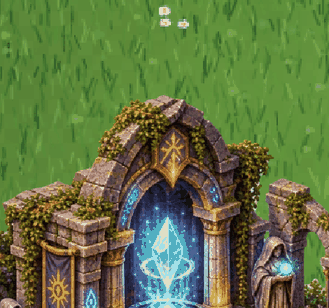
- **Castle Keep.** Delivered with real transparency, the gate facing front-left (r0) and a
  plinth that fills the 4×4 diamond, so it imports without cut-out work or mirroring. The banners
  and pennants are painted into the sprite and stay static: moving them cleanly needs the flags
  as a separate layer (an animated copy over the painted flags would ghost at the edges).

  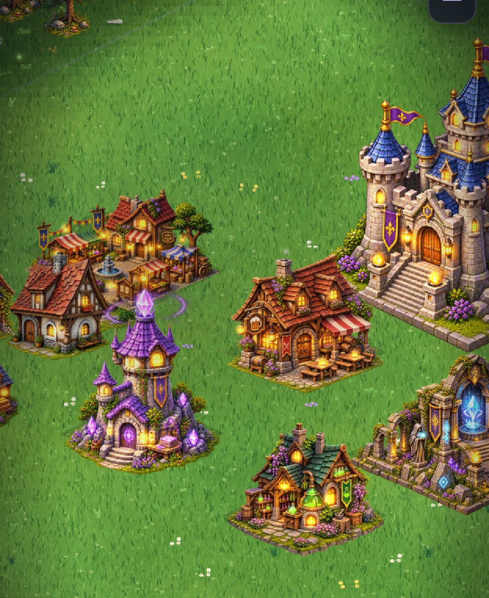
- **Similar houses.** The farmhouse and the cottage share a red-roof, stone-and-timber style,
  so they're easy to mix up at a glance. The farm's field and fence tell them apart.

## Missing rotation artwork

Only **r0** exists for the farm, sawmill, mage tower, blacksmith, alchemist, tavern, marketplace, temple and castle. The other rotations are
**temporary fallbacks**, reported by `validate:assets`:

| Building | r1 | r2 | r3 |
| --- | --- | --- | --- |
| Farm (2×3 / 3×2) | r0 mirrored | r0 | r0 mirrored |
| Sawmill (2×1 / 1×2) | r0 mirrored | r0 | r0 mirrored |
| Mage tower (2×2) | r0 mirrored | r0 | r0 mirrored |
| Blacksmith (2×1 / 1×2) | r0 mirrored (= the painting as delivered) | r0 | r0 mirrored (= as delivered) |
| Alchemist (2×2) | r0 mirrored | r0 | r0 mirrored |
| Tavern (2×2) | r0 mirrored (door front-left) | r0 | r0 mirrored (door front-left) |
| Marketplace (3×2 / 2×3) | r0 mirrored | r0 | r0 mirrored |
| Ancient Temple (3×3) | r0 mirrored (stairs front-left) | r0 | r0 mirrored (stairs front-left) |
| Castle Keep (4×4) | r0 mirrored | r0 | r0 mirrored |

Mirroring swaps the footprint's width and depth, which matches the quarter turn, so collision
lines up. But the lighting flips, and r2 shows the same front as r0 instead of the back. Painted
`_r1`, `_r2` and `_r3` images (same canvas sizes as r0; see `docs/ASSET_SPEC.md` §6) replace the
fallbacks with no code changes.
