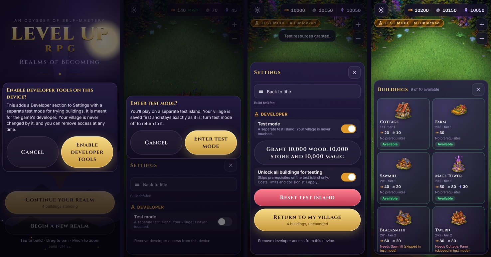

# Developer Test Mode

A separate, throwaway **test island** for trying buildings quickly: grant resources, skip
prerequisites, place anything. The player's village is never read for writing, overwritten or
changed by it.

## Using it on the live GitHub Pages build

No local development setup is needed.

1. On your phone, open **https://ukmarb-sys.github.io/level-up-rpg/?devtools=enable**.
2. Confirm **Enable developer tools** in the dialog. The `?devtools=enable` is removed from the
   address bar, so reloading or sharing the page doesn't repeat it.
3. Start the game and tap the **gear** (top left). Settings now has a **Developer** section.
4. Switch **Test mode** on and confirm. Your village is saved first, then the test island opens.
   A striped **TEST MODE** badge stays on screen (and on the title screen) while it is active.
5. On the test island:
   - **Grant 10,000 wood, 10,000 stone and 10,000 magic** (repeatable);
   - **Unlock all buildings for testing** skips prerequisites. Costs, one-per-realm limits,
     collision and painted-art gating still apply;
   - **Reset test island** (with a confirmation) wipes the test island back to a fresh start.
6. **Return to my village** (or switch Test mode off) reopens your village exactly as you left it.
   The test island is kept for next time.

To remove everything, tap **Remove developer access from this device** in Settings, or open the
game with `?devtools=disable`. This deletes the test island and hides the Developer section.

On the local dev server (`npm run dev`) the Developer section is always available.

## How it is kept safe

| Concern | How |
| --- | --- |
| Off by default | No developer access and no test settings means the normal game, exactly as before. Stored test settings are ignored on a device without access. |
| Not reachable by accident | The Developer section only exists after an explicit `?devtools=enable` plus a confirmation, per device. No in-game button, gesture or setting reveals it. |
| Village isolation | The test island uses its own save key (`levelup-rpg:test-save`). The village save (`levelup-rpg:save`) is saved before switching, then not written again until you return. A test-mode store refuses the village key, and resource grants and the prerequisite bypass are refused outside test mode (tested). |
| Return unchanged | Tests and a browser run check that the village save is byte-for-byte identical after entering test mode, granting, placing, rotating, resetting and returning. |
| Saves | The save format is still v1; the test island uses the same format under a different key. |

**Limitation (by design):** this is a static site with no server, so the gate is a deliberate
step, not a secret. Anyone who knows the URL parameter can enable test mode on their own device.
That only affects their own copy of the game in their own browser, and never their village, so
there is nothing to protect beyond preventing accidents. A real secret (a password or token) would
have to be shipped in the public JavaScript and so would not be secret either. If test mode ever
needs to be completely absent from the public build, the next step is a build-time flag
(`VITE_DEVTOOLS=0`) that strips the Developer section from production, with a separate preview
deployment for testing.

## Code

| File | What |
| --- | --- |
| `src/core/testMode.ts` | Access gate, settings, test save key, `openRealm`, `resetTestIsland` |
| `src/core/store.ts` | `saveKey`, `testMode`, `grantResources`, `setRules` (both refused outside test mode) |
| `src/core/buildings.ts` | `RuleOptions.ignoreRequirements`, catalog statuses (`catalogCard`, `catalogCards`) |
| `src/ui/SettingsPanel.tsx`, `src/ui/ConfirmDialog.tsx` | Settings sheet with the Developer section and confirmations |
| `src/App.tsx` | Switching between the village and the test island, the `?devtools` request |
| `tests/testMode.test.ts`, `tests/catalog.test.ts` | Gate, isolation, grants, unlock-all, placement, collision, rotation, reset; catalog states |
