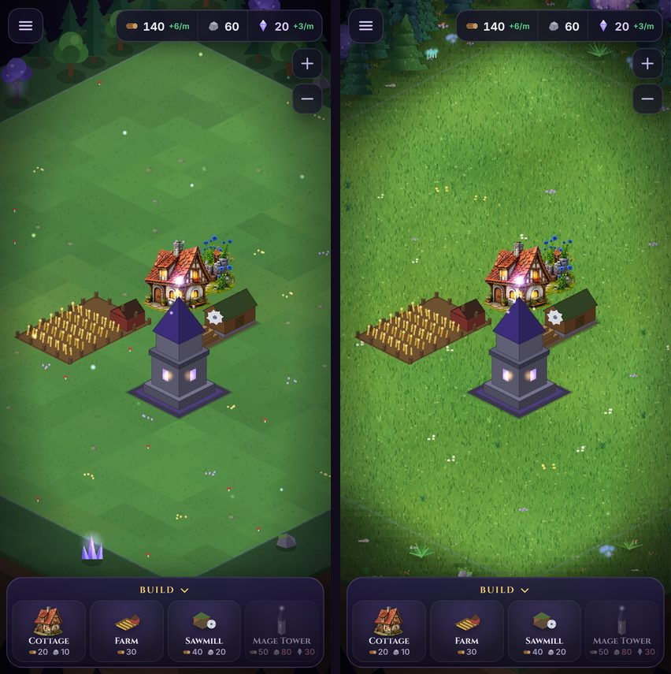
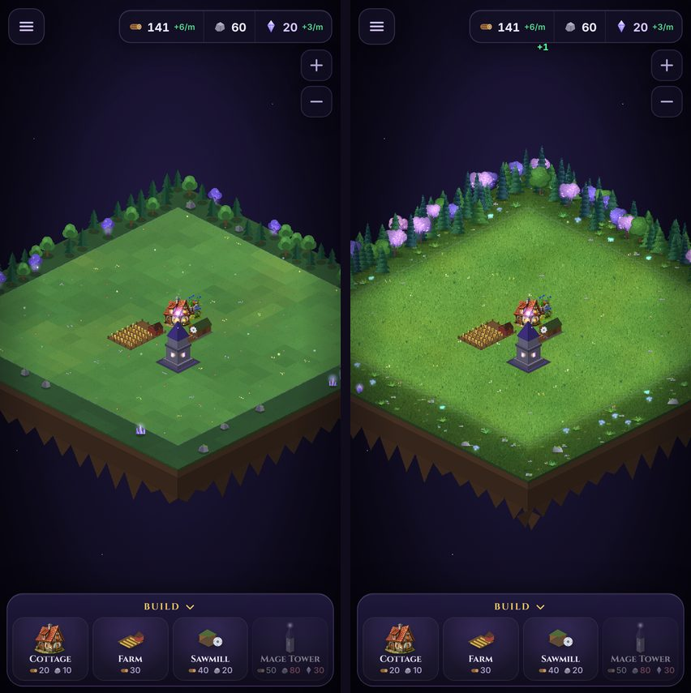
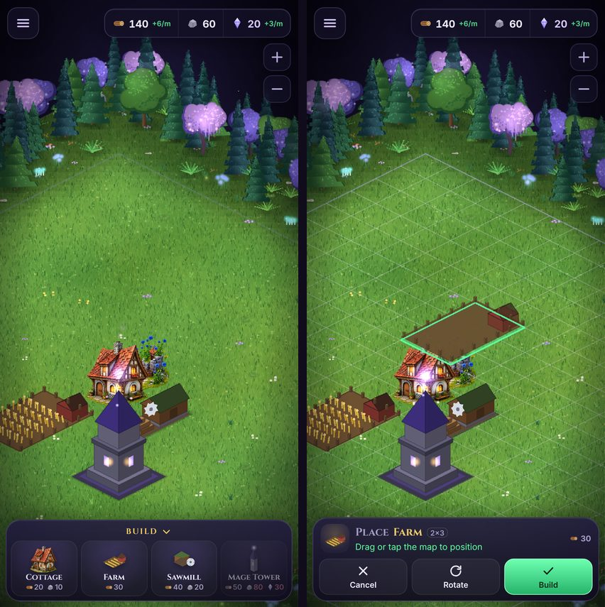
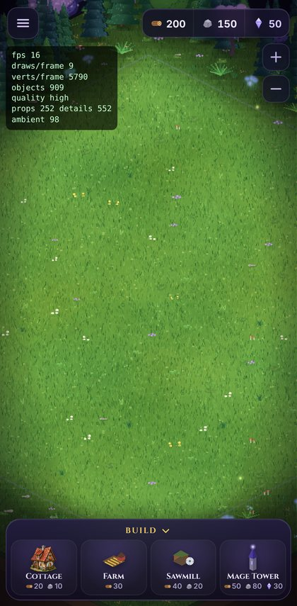

# Enchanted Wilderness — Phase 1

A cozy fantasy island: about 70% magical fairytale (lush grass, wildflowers, mystical lilac
trees, fireflies) and 30% ancient mystery (ruins, standing stones, crystals). It's built to
match the painted cottage while keeping the buildable area calm and readable on phones.

No rivers, waterfalls or other gameplay-changing terrain are included; those are a later phase.

## What is implemented

All of it is generated in code at startup: deterministic, with no image downloads.

| Feature | Implementation |
| --- | --- |
| Seamless grass | 512² canvas-painted texture (periodic value noise, about 9,000 blades, clover). One world-space TileSprite masked to the island, so there are no tile seams. Mipmapped when zoomed out. |
| Natural variation | Continuous tone field `groundTone()`: moss and warm meadow patches, shade near the back forest, forest floor deepening across the ring. Multiplied over the grass at 8 world px resolution with bilinear upscaling, so there are no steps or staircases. |
| Ground details | 12 hand-designed detail sprites (grass tufts, moss, clover, yellow/white/violet/pink wildflowers, pebbles, toadstools, fallen leaves, glowing dots) in one atlas. Sparse and flat (≤ 6 px tall) inside the grid; denser forest floor in the ring. |
| Perimeter forest | 3-tile scenery ring with 14 prop types in one atlas: pine, spruce, fir, oak, mystical weeping lilac tree, enchanted violet tree, fern, glowing teal mushrooms, glowing bellflowers, mossy boulder, small stones, ruined pillar, standing stone with a glowing rune, crystal cluster. Layered forest at the back, ancient corners, and only low undergrowth at the front. |
| Ambient life | Fireflies that wander and blink near the island edges, spores rising from mystical plants, soft pulsing glows on magical props, and the ley-line rim. One `update()` pass with no per-object tweens. |
| Painted art first | `terrain/grass_N` and every `props/*` file from the asset pipeline replace the procedural version automatically. |

## Readability and gameplay guarantees

All of these are covered by `tests/environment.test.ts`:

- **No props on the grid:** nothing decorative is placed on the 20×20 buildable grid, and
  collision, placement and saves are untouched.
- **Tall props stay clear:** tall props stand only where their silhouette rises *away* from the
  grid on screen. The test projects every tall prop's silhouette back onto the ground and checks
  it never covers a buildable tile.
- **Front edges stay low:** the front edges (towards the camera, the HUD and the build menu)
  only get low undergrowth, overlapping the outermost row by at most 0.4 of a tile.
- **Grid stays readable:** inside the grid the details are sparse (under 0.45 per tile) and flat,
  and the ground tone stays bright.
- **Not interactive:** decorations can't be tapped and never block touch input.

## Mobile (Android) performance

Measured in headless Chromium with the Pixel 7 profile, same save and camera:

| | Before | After |
| --- | --- | --- |
| WebGL draw calls per frame | 460 | 16 |
| Vertices per frame | ~111,000 | ~17,000 |
| Display objects | 576 ground tiles + ~100 per-frame-tessellated `Graphics` | about 900 batched images from 4 atlases |
| Extra GPU memory | — | about 3.3 MB (512² grass + 1024×512 props + small atlases, with mipmaps) |

"Before" was dominated by the per-frame re-tessellated `Graphics` props. Absolute FPS from a
headless software renderer doesn't reflect a phone; use the `?perf` overlay on a real device.

**Quality tiers** (`qualityFor`, picked automatically):

| Tier | When | Ground details | Fireflies | Spores |
| --- | --- | --- | --- | --- |
| High | Default | 100% | 16 | 12 |
| Low | ≤ 4 CPU cores, ≤ 3 GB RAM (`navigator.deviceMemory`) or Data Saver | 55% | 8 | 6 |
| Still | `prefers-reduced-motion` | as tier | 0 | 0 (glows don't pulse) |

**Debug switches:**
- `?perf` shows FPS, WebGL draw calls and vertices per frame, object count and the active tier.
- `?quality=low` or `?quality=high` overrides the detected tier.

## What still needs artwork

The procedural assets are usable and consistent, but they're stylised painting in code. They
don't match the hand-painted detail of the cottage. For a fully premium look, generate these
images externally and import them with `npm run art:import` (exact sizes and anchors are in
`docs/ASSET_SPEC.md` §6). Each one replaces its procedural version automatically, with no code
changes.

| Priority | File (`src/assets/art/…`) | Canvas (px) | Notes |
| --- | --- | --- | --- |
| 1 | `terrain/grass_0.png` … `grass_3.png` | 256 × 128 | Best made from **seamless square top-down grass textures** (`art:import --tile square` projects them). Painted tiles are drawn per tile and tinted by the tone field. |
| 2 | `props/tree_pine.png`, `tree_spruce.png`, `tree_fir.png` | 320 × 512 / 576 / 480 | Evergreens: the bulk of the forest |
| 2 | `props/tree_mystic.png`, `tree_enchanted.png` | 320 × 512 / 480 | Lilac weeping tree; violet enchanted tree |
| 3 | `props/tree_oak.png`, `bush_fern.png`, `glow_shroom.png`, `glow_bloom.png` | 320 × 448 / 224 / 224 / 256 | Broadleaf and undergrowth |
| 3 | `props/rock_mossy.png`, `rock_small.png`, `ruin_pillar.png`, `standing_stone.png`, `crystal_cluster.png` | 320 × 256 / 192 / 448 / 448 / 288 | Ancient-mystery accents |

Not yet supported by the asset pipeline:
- painted **ground-detail** sprites (they're procedural only);
- a painted **cliff/underside** for the floating island (it's still flat vector strata).

Both would need small manifest additions in a later phase.

## Code map

| File | Role |
| --- | --- |
| `src/game/props.ts` | Prop types' silhouettes and the deterministic forest layout |
| `src/game/environment/layout.ts` | Tone field, ground details, ambient plan, quality tiers (pure, unit-tested) |
| `src/game/environment/paint.ts` | Canvas 2D painters for grass, details, props and glow (Phaser-free) |
| `src/game/environment/textures.ts` | Packs the painted textures into Phaser atlases (once per game) |
| `src/game/environment/EnvironmentLayer.ts` | Builds the island in the scene and animates ambient life |
| `src/game/environment/device.ts` | Reads device signals and `?quality` to pick the tier |
| `src/game/createGame.ts` | Enables mipmaps; `?perf` overlay |
