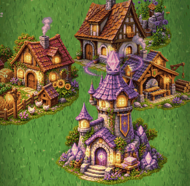
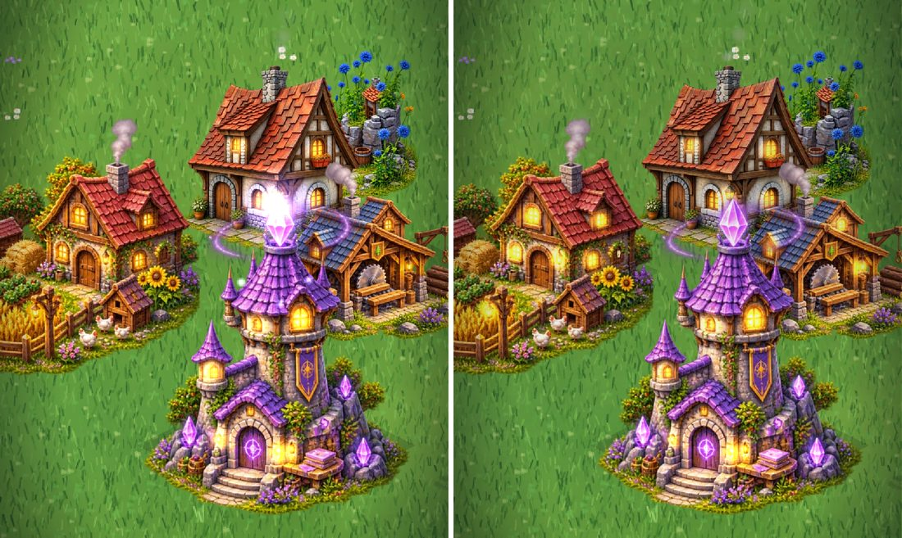

# Visual Overhaul 2.0: status

The painted cottage is the quality bar. Everything shipped here either uses real painted
artwork or is a subtle effect layered on top of it. Nothing below the bar is presented as
finished art.

## Phase 1: the existing buildings

| Building | Art | Life added in this phase |
| --- | --- | --- |
| Cottage | painted (unchanged) | unchanged: chimney smoke, window glow |
| Farm | painted | **chimney smoke** from the painted chimney, **6 lit windows** and lantern glows, **butterflies** drifting between the wheat, vegetables, sunflowers and flowers |
| Sawmill | painted | **chimney smoke**, **4 window and lantern glows**, sawdust at the blade |
| Mage tower | painted | **crystal sparkles** (5 points: ground crystals, door rune, spell book) with motes drifting up; the spire glow is **toned down** to a soft breathing halo, because the painted crystal already glows |

All effect points are measured on the painted pixels. `tests/buildingArt.test.ts` checks this
and re-imports the raw sources pixel for pixel. Butterflies and sparkle motes respect
`prefers-reduced-motion` and are reduced on the low (Android) quality tier.

## Phase 2: the building catalog

Six new buildings with a purpose, a cost and a place in the progression:

| Tier | Building | Footprint | Cost (wood / stone / magic) | Purpose | Unlocked by |
| --- | --- | --- | --- | --- | --- |
| 2 | Blacksmith | 2×1 | 60 / 20 / 0 | **+3 stone/min**, the realm's first stone income | Sawmill |
| 2 | Tavern | 2×2 | 80 / 30 / 0 | **+10% to all production** (one per realm) | Cottage + Farm |
| 3 | Marketplace | 3×2 | 120 / 60 / 0 | +2 wood and +2 stone/min | Tavern |
| 3 | Alchemist's Workshop | 2×2 | 60 / 50 / 40 | +4 magic/min | Mage Tower |
| 4 | Ancient Temple | 3×3 | 0 / 180 / 120 | **+25% magic** (one per realm) | Alchemist |
| 5 | Castle Keep | 4×4 | 300 / 300 / 150 | **+15% to all production**, the long-term goal (one per realm) | Marketplace + Temple + Blacksmith |

- **Rules** (`src/core`): unlock requirements, one-per-realm limits and production bonuses
  (which add up) are enforced in `placeBuilding`, explained by a toast, shown in the build menu
  ("Needs Sawmill", "Built") and in the action bar ("All production +10%"). A test plays a whole
  realm from a fresh start up to the Castle Keep.
- **Art-gated:** these buildings appear in the build menu **only once their painted `_r0`
  exists**. Until then the menu shows exactly the four buildings it always has. There are no
  geometric placeholders. The menu scrolls sideways when more than four are offered.
- **Saves:** format v1 is unchanged. Old saves load as before, and new building types round-trip.

## Phase 3: a living world

- **Drifting cloud shadows:** two very soft shadows (one on the low tier) pass slowly over the
  island and the buildings (up to about 15% darker at the core). Off with reduced motion.
- Butterflies, crystal sparkles, chimney smoke and window glows (Phase 1), plus the existing
  fireflies, spores and magical glows.

## Performance (Pixel 7 profile, same save)

| | main | this branch |
| --- | --- | --- |
| Draw calls per frame | 20–21 | 25–26 |
| Vertices per frame | ~4,400 | ~4,500 |

## What is genuinely finished, and what still needs external artwork

**Finished:** painted farm, sawmill, mage tower, blacksmith, Alchemist's Workshop and Tavern with living effects; the cottage, untouched;
the full rules and UI for six new buildings; cloud shadows; tests and documentation.

**Needs external artwork** (high-quality painted art can't be generated in this environment).
Exact specs and prompts are in [ART_BRIEFS.md](ART_BRIEFS.md):

1. None: all six new buildings are painted (`_r0`;
   they unlock in game automatically). The **Blacksmith**, **Alchemist's Workshop** and
   **Tavern**, **Marketplace**, **Ancient Temple** and **Castle Keep** are done.
2. `_r1`–`_r3` rotations for the farm, sawmill, mage tower and cottage (mirrored fallbacks for now).
3. Cobbled path tiles, flower beds and fences, villagers and a painted island cliff. These also
   need small code features, listed in the brief.
4. Seamless painted grass tiles (already supported).
